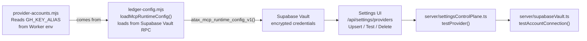
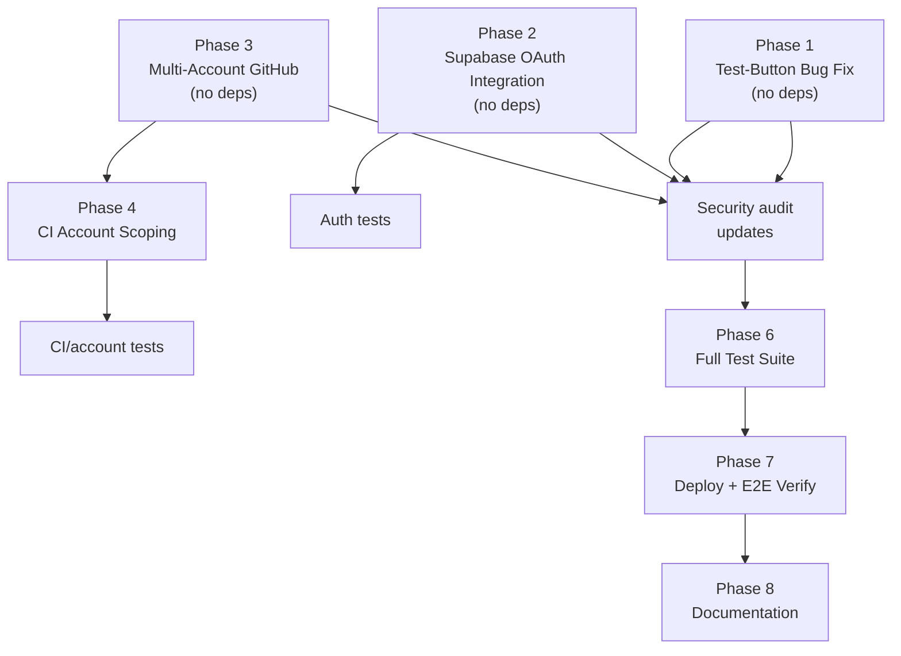

# ATAX MCP — Implementation Plan
## Remote OAuth, Multi-Account GitHub, CI Refactor & Test-Button Fix

> Generated: 2026-11-25 | Based on: `ATAX MCP — Complete Remote OAuth, Multi-Account GitHub, CI, and Provider-Test Refactor.md`

---

## Current Architecture (What Exists)

```mermaid
flowchart TD
    A["MCP Client\n(Claude / Gemini / Custom)"] -->|HTTPS POST /mcp| B["Cloudflare Worker\nworker-dashboard.ts"]
    B -->|routes /mcp| C["tools/atax-mcp/worker.mjs\ncreateHandler()"]
    C -->|authenticate()| D{Auth Mode}
    D -->|MCP_SHARED_TOKEN_SHA256| E["Shared Bearer\nToken Auth"]
    D -->|MCP_AUTH_JWKS_URL| F["JWT Verify\nvia JWKS"]
    E & F --> G["Principal resolved\n{id, authMethod, scopes}"]
    G -->|isOwnerPrincipal| H["Route RPC\nTOOLS dispatch"]
    H --> I["tools/atax-mcp/\ndata-api-ledger.mjs"]
    I -->|HTTPS PostgREST| J["Supabase\nData API"]
    H -->|resolveProviderAccount| K["tools/atax-mcp/\nprovider-accounts.mjs\nGH_KEY_<ALIAS> in env"]
    K -->|GitHub API| L["GitHub"]
    C -->|GET /.well-known/...| M["OAuth Protected\nResource Metadata"]
    M -->|MCP_AUTH_AUTHORIZATION_SERVER| N["Supabase OAuth\n(configured externally)"]
```



### Key Issues Identified

| # | Issue | Location | Severity |
|---|-------|----------|----------|
| 1 | OAuth flow: Worker advertises `authorization_servers` but does **not** perform OIDC discovery, dynamic registration, or complete PKCE flow end-to-end — these are delegated to a Supabase OAuth server that isn't yet fully integrated | `worker.mjs:dispatch()` | 🔴 Critical |
| 2 | Test-button failure: `testAccountConnection()` calls `vault.testAccountConnection(undefined, provider, alias)` — passes `undefined` as `ownerSubject`, which means the Supabase RPC that retrieves the credential may fail to resolve the right secret | `settingsControlPlane.ts:testProvider()` + `supabaseVault.ts:testAccountConnection()` | 🔴 Critical |
| 3 | Multiple GitHub accounts: architecture supports it via `GH_KEY_<ALIAS>` naming and `resolveProviderAccount()`, but `github-tools.mjs` still has single-account assumptions via `assertOwner()` locking to `MCP_GITHUB_OWNER` env var without account-scoped resolution | `github-tools.mjs` | 🟠 High |
| 4 | FMRL CI workflows don't explicitly track which GitHub account is used across the full dispatch→status→verify cycle | `github-tools.mjs:validateFmrlArgs()` | 🟠 High |
| 5 | No live Supabase OAuth OIDC endpoint, dynamic client registration, or JWKS endpoint wired to actual Supabase Auth | `worker.mjs`, docs | 🟠 High |
| 6 | `authenticate()` in `worker.mjs` requires `azp` claim — prevents legitimate token flows where `azp` isn't set | `worker.mjs:authenticate()` | 🟡 Medium |
| 7 | `testProvider` in settings control plane passes `undefined` owner → audit RPC logs wrong actor | `settingsControlPlane.ts` | 🟡 Medium |
| 8 | No regression test for Test-button bug path | - | 🟡 Medium |

---

## Implementation Plan

### Phase 1 — Fix the Test-Button Bug (Root Cause + Regression)
**Files:** `server/supabaseVault.ts`, `server/settingsControlPlane.ts`, `server/vaultAndAuth.test.ts`

**Root cause:** `testProvider()` in `settingsControlPlane.ts` calls `vault.testAccountConnection(undefined, provider, alias)`. The `ownerSubject` is `undefined`. The Supabase RPC `atax_mcp_audit_provider_test_v1` receives `actor_subject_in = undefined`, which the DB may interpret differently than the calling session's authenticated user. More critically, `resolveAccount()` inside `testAccountConnection()` calls `db.rpc('atax_mcp_get_provider_secret_v1', {...})` — if `owner_subject_in` is `undefined`/`null`, the RPC may return no row, causing a "Provider account unavailable" error that surfaces as a Test failure.

**Fix steps:**

1. **`server/settingsControlPlane.ts`** — Extract the authenticated session's owner subject before calling `vault.testAccountConnection()`. The session hash is already validated; use `db.rpc('atax_mcp_get_instance_owner_v1', {session_hash_in})` (or the existing `atax_mcp_validate_instance_session_v1` return value) to resolve the owner subject, then pass it explicitly.

   ```ts
   // testProvider() — get owner subject from session, not undefined
   async function testProvider(request, provider, alias) {
     const auth = await requireSession(request);
     if (!auth.ok) return { body: { error: auth.error }, status: auth.status };
     const hash = await sessionHashFromRequest(request);
     const ownerSubject = hash ? await resolveOwnerSubject(hash) : null;
     // pass ownerSubject explicitly instead of undefined
     return { body: await vault.testAccountConnection(ownerSubject, provider, alias), status: 200 };
   }
   ```

2. **`server/supabaseVault.ts`** — Make `testAccountConnection` reject `null`/`undefined` ownerSubject with a clear `VaultError` instead of propagating it to the RPC.

3. **`server/vaultAndAuth.test.ts`** — Add regression tests:
   - `testAccountConnection(undefined, 'github', 'PERSONAL')` → throws/rejects with clear message
   - `testAccountConnection('valid-owner', 'github', 'PERSONAL')` → succeeds (mocked vault RPC)
   - Full `settingsControlPlane.testProvider()` with no session → 401
   - Full `settingsControlPlane.testProvider()` with valid session → 200 (mock owner resolution)
   - Verify wrong account cannot be selected (account isolation)

---

### Phase 2 — Complete Supabase OAuth Integration
**Files:** `tools/atax-mcp/worker.mjs`, new `tools/atax-mcp/oauth-discovery.mjs`

**Goal:** The `/mcp` endpoint must support full OAuth 2.1 discovery so Claude/Gemini can authenticate without manual token pasting.

**What Supabase provides (already configured):**
- `GET https://<project>.supabase.co/auth/v1/.well-known/openid-configuration` — OIDC discovery
- `GET https://<project>.supabase.co/auth/v1/jwks` — JWKS public keys
- `POST https://<project>.supabase.co/auth/v1/token` — Token exchange
- Google OAuth provider already configured in Supabase Auth

**Steps:**

1. **Create `tools/atax-mcp/oauth-discovery.mjs`** — A module that:
   - Fetches and caches the Supabase OIDC discovery document
   - Builds the `/.well-known/oauth-protected-resource` response from live discovery
   - Handles dynamic client registration forwarding (Supabase supports `register` endpoint)
   - Provides `verifySupabaseJwt(token, env, fetcher)` that:
     - Fetches JWKS from `MCP_AUTH_JWKS_URL` (or auto-discovered from issuer)
     - Validates signature, `iss`, `aud`, `exp`, `azp` (now optional — many Supabase flows omit it)
     - Maps `sub` (Supabase Auth user UUID) → ATAX owner via `MCP_ATAX_OWNER_JWT_SUBJECT`

2. **Update `worker.mjs:authenticate()`:**
   - Remove hard requirement for `azp` when Supabase Auth is the issuer (Supabase-issued tokens use `aud` and `sub` for binding, not always `azp`)
   - Add proper JWKS key caching (avoid re-fetching on every request)
   - Accept both RS256 (Supabase default) and EdDSA (test keys) based on `alg` from JWT header

3. **Update `worker.mjs:dispatch()` — OAuth protected resource metadata:**
   ```js
   // /.well-known/oauth-protected-resource
   {
     "resource": "https://<worker>.workers.dev/mcp",
     "authorization_servers": ["https://<project>.supabase.co/auth/v1"],
     "bearer_methods_supported": ["header"],
     "scopes_supported": ["openid", "profile", "email", "offline_access"],
     "resource_documentation": "https://<worker>.workers.dev/.well-known/atax-mcp-info"
   }
   ```

4. **Add `/.well-known/oauth-authorization-server` forwarding** — Some MCP clients (Claude) check this path on the resource server. The Worker should proxy or redirect to Supabase's `.well-known/openid-configuration`.

5. **Dynamic client registration:** Supabase Auth supports `POST /auth/v1/clients` for dynamic registration. The Worker's `/.well-known/oauth-protected-resource` should advertise `registration_endpoint` pointing to Supabase, so clients can register without hardcoding client IDs.

6. **`MCP_AUTH_AUDIENCE` derivation:** Supabase-issued tokens set `aud` to the Supabase project URL, not the MCP endpoint URL. The `authenticate()` function must be updated to accept `aud = <supabase-project-url>` as a valid audience when `MCP_AUTH_ISSUER` is a Supabase Auth server.

---

### Phase 3 — Multi-Account GitHub Hardening
**Files:** `tools/atax-mcp/github-tools.mjs`, `tools/atax-mcp/provider-accounts.mjs`

**Current state:** `resolveProviderAccount()` in `provider-accounts.mjs` already supports multi-account correctly via `GH_KEY_<ALIAS>`. However `github-tools.mjs` has:
- `assertOwner(env)` that hardcodes `MCP_GITHUB_OWNER` as a single owner string without account scoping
- `parseRepo()` that rejects repos not under `MCP_GITHUB_OWNER` — this is correct for FMRL safety but needs to be account-aware
- FMRL `create_run_dispose` / `get_status` don't enforce that dispatch and status use the **same** GitHub account

**Steps:**

1. **`github-tools.mjs:assertOwner()`** — Remove the strict equality check against `OWNER` constant. Instead resolve owner dynamically from the selected GitHub account's actual authenticated identity (`GET /user`), and store the resolved login per-account in a request-scoped cache.

2. **`github-tools.mjs:parseRepo()`** — Change to validate that the repo owner matches the **selected account's** GitHub login, not a global `MCP_GITHUB_OWNER` env var. Store `MCP_GITHUB_OWNER` as a policy constraint (optional allowlist of permitted GitHub logins) rather than a singleton identity.

3. **`github-tools.mjs:validateFmrlArgs()`** — Add `account` parameter threading so that `create_run_dispose` and `get_status` can verify they're using the same account. Store the `account` alias in the FMRL request correlation ID response so `get_status` can confirm it.

4. **FMRL tool schemas** — Add `account` as a required field when multiple GitHub accounts are configured (consistent with existing `atax_github_repository_create` behavior).

5. **Audit all `githubRequest()` calls** — Every call must receive an explicitly selected token from `resolveProviderAccount()`, never from an env var directly.

6. **`provider-accounts.mjs:resolveProviderAccount()`** — Already correct. Add `resolveProviderAccountOrDefault()` helper that auto-selects when only one account exists (already works), and throws with a clear error listing available aliases when multiple exist.

---

### Phase 4 — CI Workflow Account Scoping
**Files:** `tools/atax-mcp/github-tools.mjs` (FMRL functions), `tools/atax-mcp/worker.test.mjs`

**Steps:**

1. **FMRL dispatch (`create_run_dispose`):**
   - Accept `account` arg (already in schema)
   - Resolve account first; store `account.alias` in the dispatch correlation record
   - Use selected account for BOTH `workflow_dispatch` trigger AND status polling
   - Return `dispatched_account` in the response

2. **FMRL status (`get_status`):**
   - Accept optional `account` arg
   - If provided, verify it matches the account recorded in the correlation ID
   - Use same account credentials to fetch run status

3. **Add CI-specific tests in `worker.test.mjs`:**
   - Dispatch with account A, status with account A → succeeds
   - Dispatch with account A, status with account B → error or fallback
   - Dispatch without specifying account when multiple configured → error "Specify an account alias"
   - Confirm credentials used in GitHub API request match the selected account (inspect captured `Authorization` headers)

---

### Phase 5 — Security Audit & Hardening
**Files:** All of `tools/atax-mcp/`, `server/`

**Items to verify and fix:**

1. **No secrets in tool results** — Audit all `invoke()` functions to ensure no token/credential values appear in returned objects. Add `sanitize()` pass over tool results.

2. **Owner isolation** — Ensure `isOwnerPrincipal()` rejects when `MCP_ATAX_OWNER_JWT_SUBJECT` is empty (already done), and that two different OAuth subjects can never both be "the owner."

3. **Account isolation** — `resolveProviderAccount()` enforces this: outsider principal → empty accounts. Add explicit test: two principals with different JWT subjects, each attempting to use the other's GitHub account.

4. **JWT validation hardening:**
   - `exp` validated → already done
   - `iss` validated → already done
   - `aud` validated → update for Supabase audience format (Phase 2)
   - `nbf` check → add if not present
   - `jti` replay protection → document as out-of-scope (stateless worker) but note the limitation

5. **JWKS caching** — Implement in-memory + timed invalidation (e.g., 5-min TTL) to avoid JWKS fetch on every `/mcp` POST.

6. **No service-role key in MCP responses** — The `__ledgerDb` binding uses `ATAX_SUPABASE_SECRET_KEY` internally but this never surfaces in tool outputs. Add explicit test.

7. **`MCP_SHARED_TOKEN_SHA256` path** — The existing bearer path must remain functional. Confirm it still works when OAuth variables are also present.

---

### Phase 6 — Comprehensive Tests
**Files:** `tools/atax-mcp/worker.test.mjs`, `tools/atax-mcp/oauth-interop.test.mjs`, `tools/atax-mcp/provider-accounts.test.mjs`, new `tools/atax-mcp/github-multi-account.test.mjs`, `server/vaultAndAuth.test.ts`

#### Authentication Tests (expand `oauth-interop.test.mjs`)
- [ ] Unauthenticated request → 401 + `WWW-Authenticate` header
- [ ] Valid Supabase JWT (RS256) → 200 tools/list
- [ ] Valid EdDSA JWT (test keys) → 200 tools/list (existing)
- [ ] Invalid signature → 401
- [ ] Wrong issuer → 401
- [ ] Wrong audience → 401 (existing)
- [ ] Expired token → 401 (existing)
- [ ] Unknown subject (not the owner) → tools filtered to public only (existing)
- [ ] Supabase Auth user UUID correctly maps to ATAX owner
- [ ] Discovery metadata (`/.well-known/oauth-protected-resource`) returns correct authorization_server URL
- [ ] Dynamic registration endpoint advertised in metadata

#### GitHub Multi-Account Tests (new `github-multi-account.test.mjs`)
- [ ] One owner + one GitHub account: `account` optional, auto-selected
- [ ] One owner + two GitHub accounts: `account` required, error without it
- [ ] Two owners (different JWT subjects): each sees only their own accounts
- [ ] Account A credential used for Account A operation (verify Authorization header)
- [ ] Account B credential used for Account B operation
- [ ] Invalid alias rejected
- [ ] Non-owner cannot select any account

#### CI Tests (expand `worker.test.mjs`)
- [ ] FMRL dispatch uses selected account credentials
- [ ] FMRL status uses same account credentials
- [ ] Mismatch in dispatch vs status account → documented behavior
- [ ] Status polling returns failure correctly

#### Test-Button Regression (expand `vaultAndAuth.test.ts`)
- [ ] `testAccountConnection(undefined, ...)` → rejects with clear error
- [ ] `testAccountConnection('owner', 'github', 'MISSING')` → provider not found
- [ ] `testAccountConnection('owner', 'github', 'VALID')` → 200 success (mocked)
- [ ] `settingsControlPlane.testProvider()` with expired session → 401
- [ ] `settingsControlPlane.testProvider()` with valid session → 200
- [ ] Verify only the requested account's credential is used (not another account's)

---

### Phase 7 — Deployment & End-to-End Verification

**Steps:**

1. **Wrangler secrets** — Confirm these are configured in the Cloudflare Worker:
   - `ATAX_SUPABASE_URL`
   - `ATAX_SUPABASE_SECRET_KEY`
   - `MCP_AUTH_AUTHORIZATION_SERVER` = `https://<project>.supabase.co/auth/v1`
   - `MCP_AUTH_ISSUER` = `https://<project>.supabase.co/auth/v1`
   - `MCP_AUTH_JWKS_URL` = `https://<project>.supabase.co/auth/v1/jwks`
   - `MCP_AUTH_AUDIENCE` = Worker URL or Supabase project URL (per Supabase token format)
   - `MCP_ATAX_OWNER_JWT_SUBJECT` = Supabase Auth `user.id` of the owner
   - `MCP_AUTH_OWNER_SCOPES` = `atax:read atax:write`

2. **GitHub account secrets** — Stored in Supabase Vault via Settings UI (not in Worker env directly)

3. **Deploy:** `wrangler deploy` from ATAX root

4. **Verification checklist:**
   ```text
   [ ] GET /health → 200 { status: 'ok' }
   [ ] GET /.well-known/oauth-protected-resource → 200 with authorization_servers
   [ ] POST /mcp with no auth → 401 + www-authenticate header
   [ ] POST /mcp with invalid JWT → 401
   [ ] Google sign-in → Supabase Auth → JWT → POST /mcp → 200 tools/list
   [ ] tools/list includes atax_context, atax_task_claim_next
   [ ] atax_context tool call → Supabase RPC returns live data
   [ ] GitHub account listed (atax_provider_accounts_list)
   [ ] GitHub repo inspect with selected account
   [ ] FMRL dispatch and status with named account
   [ ] Gemini: provide /mcp URL → OAuth discovery → Google login → tool invocation
   [ ] Claude: provide /mcp URL → OAuth discovery → Google login → tool invocation
   ```

---

### Phase 8 — Documentation
**Files:** `tools/atax-mcp/CLAUDE_GEMINI_CONNECTORS.md`, `tools/atax-mcp/OWNER_SETUP.md`, `docs/connection-modes.md`, new `docs/mcp-oauth-architecture.md`

**Updates:**
1. **`CLAUDE_GEMINI_CONNECTORS.md`** — Replace Option A/B framing with the actual Supabase OAuth flow. Document exact steps for Gemini and Claude connection. Remove language implying manual bearer token pasting is the primary path.
2. **`OWNER_SETUP.md`** — Add Supabase Auth configuration section: enabling Google provider, setting JWKS URL, mapping `user.id` to `MCP_ATAX_OWNER_JWT_SUBJECT`.
3. **`docs/connection-modes.md`** — Update Mode 3 (Remote MCP) to reflect the actual OAuth flow as implemented, not aspirational.
4. **New `docs/mcp-oauth-architecture.md`** — Full architecture diagram, sequence diagrams for OAuth flow, troubleshooting guide.

---

## File Change Summary

| File | Change Type | Phase |
|------|------------|-------|
| `server/settingsControlPlane.ts` | Bug fix — pass owner subject to vault | 1 |
| `server/supabaseVault.ts` | Bug fix — reject undefined ownerSubject | 1 |
| `server/vaultAndAuth.test.ts` | Add regression tests | 1 |
| `tools/atax-mcp/worker.mjs` | Update authenticate(), add OAuth routes | 2 |
| `tools/atax-mcp/oauth-discovery.mjs` | New — OIDC/JWKS/registration module | 2 |
| `tools/atax-mcp/oauth-interop.test.mjs` | Expand OAuth tests | 2, 5 |
| `tools/atax-mcp/github-tools.mjs` | Multi-account owner resolution | 3, 4 |
| `tools/atax-mcp/provider-accounts.mjs` | Minor hardening | 3 |
| `tools/atax-mcp/github-multi-account.test.mjs` | New — multi-account CI tests | 3, 4 |
| `tools/atax-mcp/worker.test.mjs` | Expand CI and account tests | 4, 5 |
| `tools/atax-mcp/CLAUDE_GEMINI_CONNECTORS.md` | Update connection guide | 8 |
| `tools/atax-mcp/OWNER_SETUP.md` | Add OAuth/Supabase setup | 8 |
| `docs/connection-modes.md` | Update Mode 3 description | 8 |
| `docs/mcp-oauth-architecture.md` | New — architecture doc | 8 |

---

## Execution Order & Dependencies



> **Phases 1, 2, and 3 are independent and can be developed in parallel.**
> Phase 4 depends on Phase 3. Phase 6 integrates all previous phases. Phase 7 follows Phase 6.

---

## Key Constraints (Must Not Violate)

> [!IMPORTANT]
> - Do **not** replace the Supabase Data API / PostgREST communication pipeline
> - Do **not** create a second Supabase project or OAuth provider
> - Do **not** create a parallel MCP server or move away from Cloudflare Worker
> - Do **not** store provider credentials as direct Worker secrets — they live in Supabase Vault
> - Do **not** introduce multi-tenancy — ATAX is single-owner
> - Do **not** authorize users by Google identity alone — must map to ATAX owner via `MCP_ATAX_OWNER_JWT_SUBJECT`

> [!CAUTION]
> The `MCP_ATAX_OWNER_JWT_SUBJECT` must be the **Supabase Auth user UUID** (a UUID like `a1b2c3d4-...`), **not** an email address. Supabase Auth `sub` claims are always UUIDs.

> [!WARNING]
> Supabase-issued JWTs set `aud` to the Supabase project URL, **not** the MCP endpoint. The audience validation in `authenticate()` must be updated. The existing `oauth-interop.test.mjs` tests use `resource` as the audience — these must be kept working for the EdDSA/non-Supabase test path, while adding a Supabase-compatible audience validation path.

---

## Open Questions for Owner

1. **Supabase OAuth audience format** — Does the Supabase Auth server set `aud` to the Supabase project URL or the client's configured URL? This determines `MCP_AUTH_AUDIENCE` value.
2. **Dynamic client registration** — Is `POST /auth/v1/clients` enabled on the Supabase project, or do Claude/Gemini need pre-registered client IDs?
3. **Supabase Auth user UUID** — What is the `user.id` (UUID) for the owner's Google account in Supabase Auth? This becomes `MCP_ATAX_OWNER_JWT_SUBJECT`.
4. **Second GitHub account** — Is there a second GitHub account available for live multi-account testing, or should the CI tests use fixtures?
5. **Claude MCP connector availability** — Is Claude's remote MCP connector available in the current region/plan for live testing?
