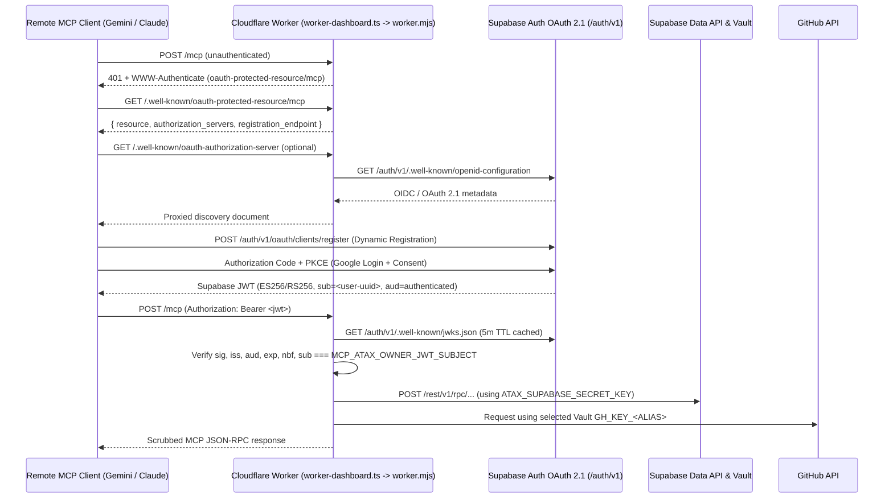

# ATAX Remote MCP OAuth 2.1 & Multi-Account Architecture

## 1. Architecture Overview

## 2. Deployed Endpoints & Configuration

- **Cloudflare Worker Entrypoint:** `wrangler.toml` (`name = "atax"`, `main = "worker-dashboard.ts"`)
- **Live MCP URL:** `https://atax.dextro1n1laevo.workers.dev/mcp`
- **Worker Secrets (Wrangler):** ONLY `ATAX_SUPABASE_URL` and `ATAX_SUPABASE_SECRET_KEY`.
- **Runtime Settings (`atax_private.mcp_server_settings` loaded via `atax_mcp_runtime_config_v1`):**
  - `MCP_AUTH_AUTHORIZATION_SERVER`: `https://<project>.supabase.co/auth/v1`
  - `MCP_AUTH_ISSUER`: `https://<project>.supabase.co/auth/v1`
  - `MCP_AUTH_JWKS_URL`: `https://<project>.supabase.co/auth/v1/.well-known/jwks.json`
  - `MCP_AUTH_AUDIENCE`: `authenticated` (or space/comma-separated list of accepted audiences)
  - `MCP_ATAX_OWNER_JWT_SUBJECT`: Supabase Auth `user.id` UUID of the owner's Google account
  - `MCP_AUTH_OWNER_SCOPES`: explicit space-separated `atax:*` scopes
  - `MCP_GITHUB_OWNER`, `MCP_FMRL_ALLOWED_TARGETS`

## 3. JWT Verification & Owner Isolation Rules

1. **Accepted Headers/Algorithms:** `typ` must be `'JWT'` (Supabase OAuth 2.1 default) or `'at+jwt'` (RFC 9068). `alg` must be `'ES256'`, `'RS256'`, or `'EdDSA'` matching the JWKS entry (`kty`/`crv`).
2. **Client Binding:** `azp` and `client_id` are optional; if present, both must satisfy safe identifier characters (`^[A-Za-z0-9_.:-]{3,160}$`).
3. **Claims Validation:** Exact `iss` match (`MCP_AUTH_ISSUER`), `aud` membership (`MCP_AUTH_AUDIENCE`), `exp > now`, `nbf <= now` (when present), and valid `sub`.
4. **JWKS Caching:** Keys are cached per `createHandler()` instance for 5 minutes; an unknown `kid` forces an immediate JWKS refresh before failing closed.
5. **Owner Pinning (`isOwnerPrincipal`):** Only when `claims.sub === env.MCP_ATAX_OWNER_JWT_SUBJECT` (and length >= 3) are `MCP_AUTH_OWNER_SCOPES` granted. Other authenticated Google/Supabase users receive no owner tools, no resources, and zero provider accounts.

## 4. Multi-Account GitHub & FMRL CI Scoping

- Credentials live in **Supabase Vault** keyed by `(owner_subject, provider, alias)` and exposed to the Worker as `GH_KEY_<ALIAS>`.
- `resolveProviderAccount(env, principal, 'github', requestedAlias)`:
  - Rejects non-owners immediately.
  - Auto-selects when exactly one account exists.
  - Requires explicit `account` alias when multiple accounts exist (never guesses or falls back).
- **FMRL Controller & Consistency:**
  - `assertOwner(env)` validates `MCP_GITHUB_OWNER` format without locking the runtime to a hardcoded developer handle.
  - `atax_fmrl_create_run_dispose` returns `{ request_id, account, dispatched_account, controller }`.
  - `atax_fmrl_get_status` accepts `account` and optional `dispatched_account`, failing closed before touching GitHub if they mismatch, and verifies cleanup via anonymous `GET /repos/<owner>/FMRL-<run_id>-<attempt>` returning `404`.

## 5. Settings UI "Test" Button Root Cause & Fix

- **Root Cause:** `server/settingsControlPlane.ts:testProvider()` previously passed `undefined` as `suppliedOwner` to `vault.testAccountConnection()`, and `testAccountConnection()` did not reject missing owner subjects up front.
- **Fix:** `testProvider()` (as well as `setEnabled()` and `deleteProvider()`) resolves the canonical owner subject via `atax_mcp_instance_owner_subject_v1` from the active authenticated session (`503` if unconfigured) and passes it explicitly; `testAccountConnection()` rejects `undefined`/`null`/`''` owner before any RPC call; `SettingsView.tsx` preserves non-2xx HTTP status codes in test result feedback.

## 6. Troubleshooting

| Symptom | Likely Cause | Fix |
| --- | --- | --- |
| Client sees `404` at `/.well-known/oauth-authorization-server` | Old Worker without route forwarding or `/auth/v1` stripped | Deploy `worker-dashboard.ts` + `worker.mjs` (both forward `/.well-known/oauth-authorization-server` and preserve `/auth/v1`) |
| Client connects & authenticates, but `tools/list` is empty (`[]`) | `MCP_ATAX_OWNER_JWT_SUBJECT` missing or set to email instead of Supabase `user.id` UUID, or `MCP_AUTH_OWNER_SCOPES` unset | Set `MCP_ATAX_OWNER_JWT_SUBJECT` to the Supabase Auth `auth.users.id` UUID and set `MCP_AUTH_OWNER_SCOPES` |
| `401 Unauthorized` with valid Supabase OAuth access token | `MCP_AUTH_AUDIENCE` mismatch (`authenticated` vs custom URL) or `typ` rejected | Verify decoded `aud` matches `MCP_AUTH_AUDIENCE` in `atax_private.mcp_server_settings` |
| GitHub tool errors with `Specify an account alias` | Two+ GitHub accounts configured and `account` omitted | Call `atax_provider_accounts_list` and pass `account: "<ALIAS>"` |
| Settings `Test` returns `404 Active Vault secret not found` | Account alias is currently `DISABLED` in Settings | Enable the alias before testing (`atax_mcp_runtime_config_v1` returns only enabled secrets) |
| Settings `Test` returns `503 Instance owner not configured` | `MCP_OWNER_SUBJECT` missing in `atax_private.mcp_server_settings` | Configure `MCP_OWNER_SUBJECT` in canonical settings |
